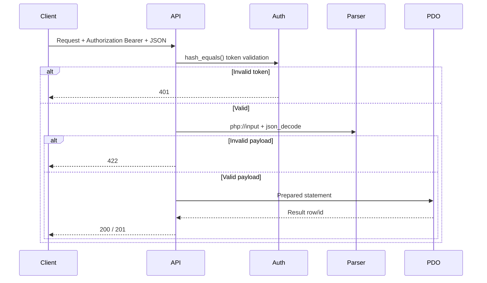

# Modern PHP Field Guide & Starter Kit

[](#)
[](#)
[](https://github.com/<OWNER>/<REPO>/actions/workflows/php-lint.yml)

A **GitHub-ready, copy-pasteable** handbook + runnable mini-system for PHP 8.2+.

## How to Navigate This Repo

```text
Start here
  ├─ README.md
  │   ├─ Master cheatsheet (quick syntax refresh)
  │   ├─ Troubleshooting index (symptom -> fix)
  │   └─ API + app usage examples
  ├─ docs/
  │   ├─ 01..05 deep-dive modules (production edge cases)
  │   └─ docs/README.md quick-run map
  ├─ public/
  │   ├─ runnable web demos (CRUD, upload, csv, oop, health)
  │   └─ api_demo.php for no-JS API testing
  ├─ api/
  │   └─ framework-free REST endpoints
  ├─ playground/
  │   └─ CLI scripts for instant terminal experimentation
  └─ deploy/
      └─ server preflight checklist script
```

## Table of Contents

- [Master Table of Contents & Learning Roadmap](#master-table-of-contents--learning-roadmap)
- [Quick Start (Runnable Demo)](#1-quick-start-runnable-demo)
- [Repository Layout](#2-repository-layout)
- [Deep-Dive Docs](#3-deep-dive-docs)
- [07 - CLI Scripts and Cron](./docs/07-cli-scripts-and-cron.md)
- [08 - Sync and Async PHP](./docs/08-sync-and-async-php.md)
- [Playground (CLI Practice Scripts)](#4-playground-cli-practice-scripts)
- [Master Cheatsheet (Copy/Paste)](#5-master-cheatsheet-copypaste)
- [Feature Walkthrough](#6-feature-walkthrough)
- [API Examples](#7-api-examples)
- [Troubleshooting & Common PHP "Gotchas" Index](#8-troubleshooting--common-php-gotchas-index)
- [Security Defaults Included](#9-security-defaults-included)
- [Next Upgrade Ideas](#10-next-upgrade-ideas)

## Master Table of Contents & Learning Roadmap

### Track 1: Beginner Path
- Start with the hub: [`./README.md`](./README.md)
- CLI playground practice:
  - [`./playground/01-arrays-and-strings.php`](./playground/01-arrays-and-strings.php)
  - [`./playground/02-dates-and-money.php`](./playground/02-dates-and-money.php)
  - [`./playground/03-modern-php8-features.php`](./playground/03-modern-php8-features.php)
- Core docs index + fundamentals:
  - [`./docs/README.md`](./docs/README.md)
  - [`./docs/01-advanced-queries-and-sorting.md`](./docs/01-advanced-queries-and-sorting.md)
  - [`./docs/02-files-and-csv.md`](./docs/02-files-and-csv.md)
  - [`./docs/04-modern-php8-oop-and-composer.md`](./docs/04-modern-php8-oop-and-composer.md)

### Track 2: Building the CRUD & API App
- Web app pages (`public/`):
  - [`./public/index.php`](./public/index.php)
  - [`./public/create.php`](./public/create.php)
  - [`./public/edit.php`](./public/edit.php)
  - [`./public/delete.php`](./public/delete.php)
  - [`./public/api_demo.php`](./public/api_demo.php)
  - [`./public/sort_demo.php`](./public/sort_demo.php)
  - [`./public/pagination_demo.php`](./public/pagination_demo.php)
  - [`./public/upload_demo.php`](./public/upload_demo.php)
  - [`./public/export_tasks_csv.php`](./public/export_tasks_csv.php)
  - [`./public/import_tasks_csv.php`](./public/import_tasks_csv.php)
  - [`./public/login_demo.php`](./public/login_demo.php)
  - [`./public/health.php`](./public/health.php)
  - [`./public/oop_demo.php`](./public/oop_demo.php)
- API endpoints (`api/`):
  - [`./api/tasks.php`](./api/tasks.php)
  - [`./api/gateway.php`](./api/gateway.php)
- Build-focused docs:
  - [`./docs/03-api-auth-and-hardening.md`](./docs/03-api-auth-and-hardening.md)
  - [`./docs/05-production-checklist.md`](./docs/05-production-checklist.md)
  - [`./docs/06-from-procedural-to-mvc.md`](./docs/06-from-procedural-to-mvc.md)

### Track 3: Senior Edge Cases & Architecture
- Advanced docs:
  - [`./docs/10-code-review-challenges.md`](./docs/10-code-review-challenges.md)
  - [`./docs/07-cli-scripts-and-cron.md`](./docs/07-cli-scripts-and-cron.md)
  - [`./docs/08-sync-and-async-php.md`](./docs/08-sync-and-async-php.md)
  - [`./docs/09-architecture-diagrams.md`](./docs/09-architecture-diagrams.md)
- CLI scripts directory (`bin/`):
  - [`./bin/README.md`](./bin/README.md)
- Test directory (`tests/`):
  - [`./tests/README.md`](./tests/README.md)

## 1) Quick Start (Runnable Demo)

### Requirements
- PHP **8.2+**
- `pdo_sqlite` enabled (default path) or MySQL + PDO
- cURL extension enabled for `public/api_demo.php`

### Boot
```bash
cd modern-php-guide
php -r "new PDO('sqlite:database.sqlite');"
php -r "\$pdo=new PDO('sqlite:database.sqlite');\$sql=file_get_contents('schema.sql');\$pdo->exec(\$sql); echo 'Schema loaded'.PHP_EOL;"
php -S localhost:8000
```

Open:
- `http://localhost:8000/public/index.php`
- `http://localhost:8000/public/api_demo.php`

## 2) Repository Layout

```text
modern-php-guide/
├── composer.json
├── README.md
├── schema.sql
├── config/
│   └── database.php
├── includes/
│   ├── security.php
│   └── header.php
├── docs/
│   ├── 01-advanced-queries-and-sorting.md
│   ├── 02-files-and-csv.md
│   ├── 03-api-auth-and-hardening.md
│   ├── 04-modern-php8-oop-and-composer.md
│   ├── 05-production-checklist.md
│   ├── 06-from-procedural-to-mvc.md
│   ├── 07-cli-scripts-and-cron.md
│   ├── 08-sync-and-async-php.md
│   ├── 09-architecture-diagrams.md
│   └── 10-code-review-challenges.md
├── playground/
│   ├── 01-arrays-and-strings.php
│   ├── 02-dates-and-money.php
│   └── 03-modern-php8-features.php
├── bin/
│   └── README.md
├── src/
│   ├── Domain/
│   │   ├── Task.php
│   │   └── TaskStatus.php
│   ├── Repository/
│   │   └── TaskRepository.php
│   └── Support/
│       └── Db.php
├── public/
│   ├── index.php
│   ├── create.php
│   ├── edit.php
│   ├── delete.php
│   ├── api_demo.php
│   ├── sort_demo.php
│   ├── pagination_demo.php
│   ├── upload_demo.php
│   ├── export_tasks_csv.php
│   ├── import_tasks_csv.php
│   ├── login_demo.php
│   ├── health.php
│   └── oop_demo.php
├── deploy/
│   └── checklist.sh
├── tests/
│   └── README.md
└── api/
    ├── gateway.php
    └── tasks.php
```

## 3) Deep-Dive Docs

- [Docs Index (quick-run map)](./docs/README.md)
- [01 - Advanced Queries and Sorting](./docs/01-advanced-queries-and-sorting.md)
- [02 - Files and CSV](./docs/02-files-and-csv.md)
- [03 - API Auth and Hardening](./docs/03-api-auth-and-hardening.md)
- [04 - Modern PHP 8 OOP and Composer](./docs/04-modern-php8-oop-and-composer.md)
- [05 - Production Checklist](./docs/05-production-checklist.md)
- [06 - From Procedural to MVC-lite](./docs/06-from-procedural-to-mvc.md)
- [07 - CLI Scripts and Cron](./docs/07-cli-scripts-and-cron.md)
- [08 - Sync and Async PHP](./docs/08-sync-and-async-php.md)
- [09 - Architecture Diagrams](./docs/09-architecture-diagrams.md)
- [10 - Code Review Challenges](./docs/10-code-review-challenges.md)

### Architecture Diagram Previews

#### Full-Stack Request Lifecycle

```mermaid
flowchart TD
    U[Browser User] --> F[public/index.php\nSearch + Category + Date Filters]
    F --> S[CSRF + Validation + Security Helpers]
    S --> W[Dynamic SQL WHERE Builder\nallowlist filters]
    W --> P[PDO Prepared Statements]
    P --> D[(tasks table)]
    D --> E[XSS Escape with e()/htmlspecialchars]
    E --> H[HTML Table Response]
    H --> U
```

#### Sync Request vs Async Worker

```mermaid
flowchart LR
    A[Client Request] --> B[PHP-FPM Request Handler]
    B --> C[Slow Work in Request Path]
    C --> D[Delayed Response]

    B --> E[fastcgi_finish_request()\nflush response early]
    E --> F[Queue Job in DB]
    F --> G[Cron/Supervisor starts bin/worker.php]
    G --> H[Background processing + done/failed status]
```

#### REST API + Auth + JSON Flow



## 4) Playground (CLI Practice Scripts)

Run from repo root:

```bash
cd modern-php-guide
php playground/01-arrays-and-strings.php
php playground/02-dates-and-money.php
php playground/03-modern-php8-features.php
```

What each script covers:
- `playground/01-arrays-and-strings.php`: destructuring, array map/filter/reduce, `array_column`, string helpers, regex extraction.
- `playground/02-dates-and-money.php`: immutable dates, timezone conversion, date ranges, and integer-cents money safety.
- `playground/03-modern-php8-features.php`: enums, `match`, nullsafe operator, named arguments, readonly classes, generators and fibers.

## 5) Master Cheatsheet (Copy/Paste)

### Strict Types + Typed Properties
```php
<?php
declare(strict_types=1);

final class Task {
    public int $id;
    public string $title;
    public ?string $dueDate = null;
}
```

### Null Coalescing + Nullsafe Patterns
```php
$q = $_GET['q'] ?? '';
$priority = (int) ($_POST['priority'] ?? 3);
```

### `match` Expression
```php
$label = match ($status) {
    'pending' => 'Pending',
    'in_progress' => 'In Progress',
    'done' => 'Done',
    default => 'Unknown',
};
```

### Named Arguments
```php
setcookie(
    name: 'session_hint',
    value: 'ok',
    expires_or_options: ['httponly' => true, 'samesite' => 'Lax']
);
```

### Secure PDO (Always)
```php
$pdo = new PDO($dsn, $user, $pass, [
    PDO::ATTR_ERRMODE => PDO::ERRMODE_EXCEPTION,
    PDO::ATTR_DEFAULT_FETCH_MODE => PDO::FETCH_ASSOC,
    PDO::ATTR_EMULATE_PREPARES => false,
]);

$stmt = $pdo->prepare('SELECT * FROM tasks WHERE status = :status');
$stmt->execute(['status' => 'pending']);
$rows = $stmt->fetchAll();
```

### Safe Dynamic WHERE Builder
```php
$filters = ['status' => $_GET['status'] ?? '', 'q' => $_GET['q'] ?? ''];
$where = build_where_clause($filters, ['status' => 'status', 'q' => 'title']);
$sql = 'SELECT * FROM tasks' . $where['sql'];
$stmt = $pdo->prepare($sql);
$stmt->execute($where['params']);
```

### XSS Escaping
```php
function e(string $value): string {
    return htmlspecialchars($value, ENT_QUOTES | ENT_SUBSTITUTE, 'UTF-8');
}

echo e($row['title']);
```

### CSRF Tokens
```php
<input type="hidden" name="csrf_token" value="<?= e(csrf_token()) ?>">
```

```php
if (!verify_csrf($_POST['csrf_token'] ?? null)) {
    throw new RuntimeException('Invalid CSRF token');
}
```

### Password Hashing
```php
$hash = password_hash($plainPassword, PASSWORD_DEFAULT);

if (!password_verify($loginPassword, $hash)) {
    // reject login
}
```

### Validation Pattern
```php
$errors = [];
$title = trim((string) ($_POST['title'] ?? ''));
if ($title === '' || mb_strlen($title) > 150) {
    $errors[] = 'Title is required and <= 150 chars';
}
```

### JSON API Response Pattern
```php
header('Content-Type: application/json; charset=utf-8');
http_response_code(201);
echo json_encode(['message' => 'created'], JSON_PRETTY_PRINT);
```

## 6) Feature Walkthrough

### Web UI (`public/`)
- `index.php`: read/list + live search + category/status/date filters + mobile-safe table
- `create.php`: create with sticky values, validation, CSRF
- `edit.php`: update with pre-filled values + validation
- `delete.php`: POST-only deletion with CSRF
- `api_demo.php`: no-JS API console using PHP cURL

### REST API (`api/tasks.php`)
- `GET /api/tasks.php`
- `POST /api/tasks.php`
- `PUT /api/tasks.php`
- `DELETE /api/tasks.php`
- Proper HTTP codes: `200`, `201`, `404`, `405`, `422`, `500`

## 7) API Examples

### GET
```bash
curl "http://localhost:8000/api/tasks.php?status=pending&category=office"
```

### POST
```bash
curl -X POST http://localhost:8000/api/tasks.php \
  -H "Content-Type: application/json" \
  -d '{"title":"Audit UPS Units","description":"Check battery health","category":"it","quantity":2,"status":"pending","due_date":"2026-12-01","priority":4}'
```

### PUT
```bash
curl -X PUT http://localhost:8000/api/tasks.php \
  -H "Content-Type: application/json" \
  -d '{"id":1,"status":"done","priority":2}'
```

### DELETE
```bash
curl -X DELETE http://localhost:8000/api/tasks.php \
  -H "Content-Type: application/json" \
  -d '{"id":1}'
```

## 8) Troubleshooting & Common PHP "Gotchas" Index

| Symptom / Error | Exact Fix | See in Repo |
|---|---|---|
| 1) "My PDO `LIMIT :limit` query throws a SQL syntax error" | Keep `PDO::ATTR_EMULATE_PREPARES => false` and bind `LIMIT`/`OFFSET` as integers via `bindValue(..., PDO::PARAM_INT)`. Do not quote numeric limit values. | [`config/database.php`](./config/database.php), [`public/pagination_demo.php`](./public/pagination_demo.php), [`docs/01-advanced-queries-and-sorting.md`](./docs/01-advanced-queries-and-sorting.md) |
| 2) "My date-range filter misses records from the selected end date" | Convert local date inputs to UTC and use a half-open range: `>= start` and `< next_day_start` instead of `<= 23:59:59`. | [`docs/01-advanced-queries-and-sorting.md`](./docs/01-advanced-queries-and-sorting.md), [`public/pagination_demo.php`](./public/pagination_demo.php) |
| 3) "Refreshing after submit duplicates a DB entry" | Use PRG (Post/Redirect/Get): after successful insert/update, set flash + `redirect(...)` and `exit`. | [`public/create.php`](./public/create.php), [`public/edit.php`](./public/edit.php), [`includes/security.php`](./includes/security.php) |
| 4) "My `$_POST` or `$_FILES` is empty on large uploads" | Raise `post_max_size` to be **greater than or equal to** `upload_max_filesize`, and verify `max_file_uploads`, `max_input_time`, `memory_limit`. Also check upload error codes server-side. | [`public/upload_demo.php`](./public/upload_demo.php), [`docs/02-files-and-csv.md`](./docs/02-files-and-csv.md) |
| 5) "My REST API gets empty `$_POST` with JSON fetch/Axios/cURL" | For JSON requests, read raw body: `file_get_contents('php://input')` + `json_decode(...)`. `$_POST` is form-encoded, not JSON. | [`api/tasks.php`](./api/tasks.php), [`public/api_demo.php`](./public/api_demo.php), [`docs/03-api-auth-and-hardening.md`](./docs/03-api-auth-and-hardening.md) |
| 6) "Headers already sent" when redirecting/cookies | Send headers before any output, keep `<?php` at file start (no BOM/whitespace before it), and centralize redirects/cookies in early execution paths. | [`includes/security.php`](./includes/security.php), [`public/create.php`](./public/create.php), [`public/edit.php`](./public/edit.php), [`public/delete.php`](./public/delete.php) |
| 7) "Emojis become `????` in MySQL" | Use `utf8mb4` end-to-end (`charset=utf8mb4` in DSN + DB/table/column collation set to utf8mb4). Never use legacy `utf8` for modern emoji-safe apps. | [`config/database.php`](./config/database.php), [`public/import_tasks_csv.php`](./public/import_tasks_csv.php), [`docs/04-modern-php8-oop-and-composer.md`](./docs/04-modern-php8-oop-and-composer.md) |
| 8) "`in_array()` returns true for wrong string/number" | Always enable strict mode for allowlists: `in_array($value, $allowed, true)`. | [`public/create.php`](./public/create.php), [`public/edit.php`](./public/edit.php), [`public/import_tasks_csv.php`](./public/import_tasks_csv.php), [`public/upload_demo.php`](./public/upload_demo.php) |
| 9) "cURL HTTPS localhost fails silently" | Check `curl_errno()` / `curl_error()` and HTTP status. In local dev only, you may temporarily set `CURLOPT_SSL_VERIFYPEER => false` and `CURLOPT_SSL_VERIFYHOST => 0`; keep verification ON in production. | [`public/api_demo.php`](./public/api_demo.php), [`docs/03-api-auth-and-hardening.md`](./docs/03-api-auth-and-hardening.md) |
| 10) "`foreach` by-reference corrupts last array item" | After `foreach ($arr as &$value)`, immediately run `unset($value);` to break lingering reference before another loop/use. | [`docs/04-modern-php8-oop-and-composer.md`](./docs/04-modern-php8-oop-and-composer.md), [`README.md`](./README.md) |

## 9) Security Defaults Included
- Output escaping with `e()`
- CSRF token generation + verification
- Prepared statements only
- Strict PDO error handling
- Safe dynamic filter builder (allowlist columns)
- Input validation on web and API flows

## 10) Next Upgrade Ideas
- Add login + roles (`users`, `password_hash`, ownership checks)
- Add pagination and sorting allowlist
- Add unit tests for validation + API handlers
- Add `.env` loader for cleaner secrets config
