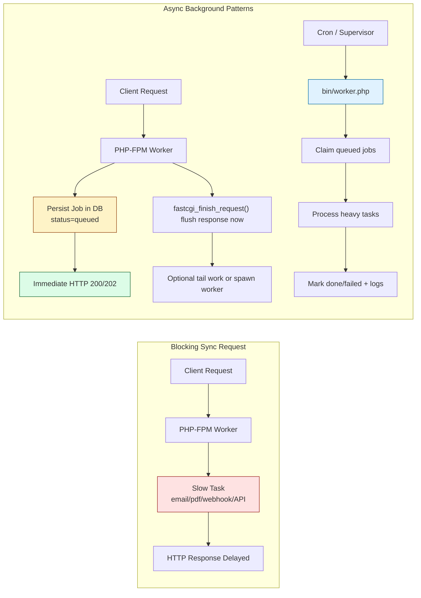
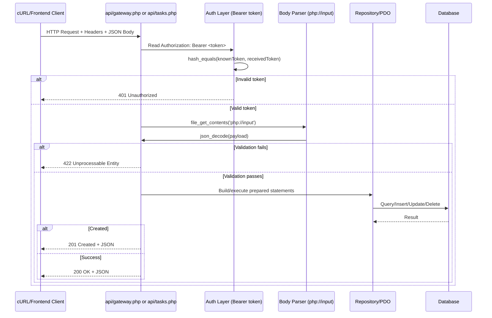

# 09) Architecture Diagrams (Mermaid Visual Guide)

This page provides visual maps for the core flows in this repo.

---

## 1) Full-Stack Request Lifecycle (Filters → Validation → SQL → Escaped HTML)

```mermaid
flowchart TD
    U[Browser User] --> F[public/index.php\nSearch + Category + Date Filters]
    F --> S[includes/security.php\nCSRF + input sanitization + helpers]
    S --> V[Server-side Validation\nstatus/category/date checks]
    V --> W[build_where_clause()\nAllowlist-based Dynamic SQL WHERE]
    W --> P[PDO Prepared Statement\nERRMODE_EXCEPTION + FETCH_ASSOC]
    P --> D[(SQLite/MySQL tasks table)]
    D --> R[Rows fetched]
    R --> E["XSS Escape with e() / htmlspecialchars()"]
    E --> H[Render HTML table\nresponsive + mobile scroll]
    H --> U

    style S fill:#e0f2fe,stroke:#0369a1
    style W fill:#fef3c7,stroke:#92400e
    style P fill:#dcfce7,stroke:#166534
    style E fill:#fee2e2,stroke:#991b1b
```

---

## 2) Sync Request vs Async Worker Patterns



---

## 3) REST API + cURL Authentication/Data Flow



---

## Diagram usage notes

- Use these diagrams in onboarding docs and PR descriptions.
- Keep labels implementation-aware (`build_where_clause`, `php://input`, `hash_equals`, `bin/worker.php`).
- Update diagrams when flow changes (new auth layer, queue backend, or router behavior).

---

## Exporting diagrams to PNG/SVG

### Option 1: GitHub preview (quickest)
- Open this markdown file in GitHub.
- View each Mermaid diagram render.
- Use browser screenshot tooling for quick PNG export.

### Option 2: VS Code (repeatable)
- Open this file in VS Code.
- Use a Mermaid preview extension.
- Export each diagram as PNG/SVG from the extension command palette.

### Option 3: Mermaid CLI (automation-friendly)

Create `diagram.mmd` with a single Mermaid block, then run:

```bash
npx -y @mermaid-js/mermaid-cli -i diagram.mmd -o diagram.svg
npx -y @mermaid-js/mermaid-cli -i diagram.mmd -o diagram.png
```

Tips:
- Prefer SVG for docs (sharp, scalable, diff-friendly).
- Prefer PNG for slide decks and chat attachments.
- Keep source Mermaid in git, export artifacts only when needed.
